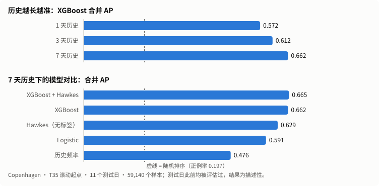

# Encounter Lab · 相遇实验室

**两个人在未来 24 小时内会不会相遇？** 本项目用 Copenhagen Networks Study 的匿名蓝牙接近记录研究这个问题：只看 t 之前的历史，预测 (t, t+24h] 内是否会再次接近，并严格防止数据泄漏、不把缺失观测当成"没相遇"。项目同时提供一个 Streamlit 应用，包括趣味问卷、公开数据分析和完整的科研工具。

[](https://github.com/Hilbert-sun/Machine-Learning-Experiment-Design-Predicting-Whether-Two-People-Will-Meet-in-the-Next-24-Hours/actions/workflows/ci.yml) [](https://hjm59payrde6ronekgiqsn.streamlit.app/)

**[在线体验 →](https://hjm59payrde6ronekgiqsn.streamlit.app/)** 不用安装，直接试 Play 趣味问卷和 Explore 公开数据分析；科研工具需要本地数据，只能本地运行。



**结论（T35–T37 滚动验证，11 个测试日）**

1. **历史越长越准。** 7 天历史比 1 天高 +0.090 AP（日块 95% 区间 [0.073, 0.103]），11 天全部为正。
2. **信号主要来自最近接触的时间结构。** 不用标签、每对只有两个参数的 Hawkes 自激过程 AP 为 0.629，接近 XGBoost 的 0.662；把 Hawkes 分数再加进 XGBoost，只多 +0.003。
3. **只能作描述性结论。** 测试日以前都被评估过，区间只描述日间波动，也没有独立总体验证。详见[研究结果与适用总体](#研究结果与适用总体)。

图由 [docs/figures/build_readme_figure.py](docs/figures/build_readme_figure.py) 从公开聚合结果生成。

## 快速开始

使用 Python 3.11，在 macOS/Linux 终端执行：

```sh
git clone --branch research-v2.2 https://github.com/Hilbert-sun/Machine-Learning-Experiment-Design-Predicting-Whether-Two-People-Will-Meet-in-the-Next-24-Hours.git encounter-lab
cd encounter-lab
python3.11 -m venv .venv
source .venv/bin/activate
python -m pip install -r requirements.txt
python -m streamlit run app.py
```

浏览器打开终端显示的地址（通常是 http://localhost:8501）。[在线演示](https://hjm59payrde6ronekgiqsn.streamlit.app/)只开放 Play、Explore 和公开报告，部署方法见[在线演示部署](docs/DEPLOY.md)。如果只在本机预览，可以在启动命令后加 `--server.address 127.0.0.1`。Linux 上的原生树模型需要 OpenMP 运行时（CI 使用 libgomp1），macOS 可能需要 libomp。当前版本在 [`research-v2.2`](https://github.com/Hilbert-sun/Machine-Learning-Experiment-Design-Predicting-Whether-Two-People-Will-Meet-in-the-Next-24-Hours/tree/research-v2.2) 分支。

| 想体验什么 | 入口 | 是否需要本地真实数据/模型 |
| --- | --- | --- |
| 趣味偶遇指数 | Home → Play，回答七道选择题 | 不需要 |
| 个人线索与图谱 | Play 结果 → 查看我的偶遇分析 | 只需当前会话中的有效问卷 |
| 公开群体规律 | Explore → 真实数据中的相遇规律 | 不需要，读取仓库中已审查的聚合报告 |
| 历史科研与模型 | Research 分类目录 | 需要对应的本地数据、模型和版本证据；缺失时显示空状态 |

**Play 的趣味指数来自固定规则，不是真实相遇概率**，也和科研模型完全独立。规则见[产品计划](docs/PRODUCT_PLAN.md)，Explore 的口径见 [Explore 指南](docs/EXPLORE_GUIDE.md)，演示流程见[五分钟演示](docs/DEMO_GUIDE.md)。

## 研究结果与适用总体

这些结果都基于 Copenhagen 的扫描覆盖率代理标签：只有观测充分的完整时段，才能把"没接触"记为负例，其余记为 Unknown，不计入二分类指标。不同实验的总体不同，表中数值不能跨行直接比较。

| Copenhagen evidence | Test population | XGBoost AP | ROC-AUC | Brier |
| --- | --- | --- | --- | --- |
| T17 sigmoid baseline | 260,170 samples, 6 dates, 10.22% positive | 0.381491 | 0.750717 | 0.077673 |
| T22 fixed cohort, 1d history | 25,569 samples, 4 dates, 21.38% positive | 0.588723 | 0.770656 | 0.128026 |
| T22 fixed cohort, 3d history | same T22 cohort | 0.627494 | 0.799719 | 0.120801 |
| T22 fixed cohort, 7d history | same T22 cohort | 0.691366 | 0.841494 | 0.109107 |
| T30 expanded, reliably labeled and predictable, 7d | 27,802 samples, same exposed 4 dates, 27.70% positive | 0.758930 | 0.854281 | 0.128114 |

- **T22**：同一批候选、标签和清除后的划分，只改变历史窗口长度，7d−1d 的 AP 差为 0.102644。**Only four principal test dates, scan-proxy labels and no independent population validation**：这些结果不能证明显著性、因果关系或长期泛化。T17 使用不同的队列和 14 天特征库，不能当作窗口对比。
- **T30**：38,005 个历史候选中，27,820 个有可靠标签，10,185 个为 Unknown。新增的 12,436 个候选里只有已知正例、没有已知负例，所以 T30 较高的 AP **not a same-population model improvement**，Brier 反而比 T22 差。见[审计证据](docs/FINAL_RESEARCH_AUDIT.md)。
- **T35–T37**：协议不变，改为滚动起点，得到 11 个测试日（59,140 个样本，正例率 19.66%），对应上图。按人排序指标 NDCG@5：7 天 XGBoost 0.786，Hawkes 0.784。见[滚动验证](studies/rolling_validation/README.md)、[Hawkes 基线](studies/hawkes_baseline/README.md)和 [Hawkes 特征](studies/hawkes_features/README.md)。
- **T38 留出参与者**：只用 A 组参与者之间的配对训练，在两人都没见过的 B–B 配对上测试，XGBoost 合并 AP 为 0.651（5 种划分的范围 0.631–0.666），比见过所有人的模型低约 0.017。这个差距同时包含"没见过这些人"和"训练数据只剩约 1/4"两个因素。见[留出参与者验证](studies/participant_holdout/README.md)。
- **T32 性能**：同一机器、同一输入，每种配置运行 5 个独立进程。MIT 冷启动峰值内存下降 27.59%；Copenhagen 部分热启动的特征和预测操作耗时约下降 97.9% 和 95.0%；部分冷启动路径变慢。见[性能证据](PERFORMANCE_AUDIT.md)。

其他数据源：Workplace 只支持已观测正例的检索，High School 只支持有限的描述性检索；MIT Reality Mining 的时间单位未核实；Social Evolution 不可用。各数据源的身份按来源分别命名，从不跨数据集合并，见[多数据源研究](MULTISOURCE_STUDY.md)。

## 方法要点

- 时间顺序划分训练、验证和测试集，并严格清除跨边界的 24 小时标签窗口；阈值和校准只用验证集。
- 共享候选集，1/3/7 天有界特征，冻结的模型，以及明确的模型信息截止时间。
- 独立的 Time Machine：Select → Predict → Freeze → Reveal；无法可靠判定的"没接触"保持 Unknown。
- 总体与选择偏差审计、按数据源的网络探索，以及固定规则的 Top-K 检索。
- Parquet/PyArrow 处理、稳定的归档快照，以及带输出一致性检查的版本化缓存。
- 技术栈：pandas、NumPy、scikit-learn、XGBoost、LightGBM、SciPy、NetworkX、Streamlit、Plotly。模块结构见[作品集架构说明](docs/PORTFOLIO_GUIDE.md)。

## 应用页面

| Page | Purpose |
| --- | --- |
| [Overview](pages/0_Overview.py) | Public Home with Play/Explore/Research entries; original statistics available in Research Hub |
| [Data Manager](pages/1_Data_Manager.py) | Explicit download, validation and preprocessing |
| [Data Explorer](pages/2_Data_Explorer.py) | Contact distributions |
| [Encounter Network](pages/3_Encounter_Network.py) | Historical network visualization |
| [Model Training](pages/4_Model_Training.py) | Explicit legacy training workflows |
| [Prediction Lab](pages/5_Prediction_Lab.py) | Legacy saved-model prediction |
| [Model Evaluation](pages/6_Model_Evaluation.py) | Saved evaluation and calibration |
| [Data Sources](pages/7_Data_Sources.py) | Provenance and source limitations |
| [History Window Study](pages/8_History_Window_Study.py) | Frozen bounded-window comparisons |
| [Dataset Catalog](pages/9_Dataset_Catalog.py) | Source quality and availability |
| [Time Machine](pages/10_Time_Machine.py) | Independent historical prediction and reveal |
| [Multi-Dataset Exploration](pages/11_Multi_Dataset_Exploration.py) | Descriptive topology and positive retrieval |
| [Chance Encounter · Play](pages/12_Chance_Encounter.py) | Session-only rule-based entertainment index and sourced keyword cards |
| [Encounter Insights · Explore](pages/13_Encounter_Insights.py) | Personal clue explanations/diagram and separate public research stories |
| [Research Hub](pages/14_Research_Hub.py) | Categorized research directory, opt-in original overview and report links |

应用的一级导航只有 Home / Play / Explore / Research 四个入口，科研页面收在 Research 分类目录里。导航在 [app.py](app.py) 和 [src/ui.py](src/ui.py) 中定义。T30 审计没有单独的页面，见 [ASOF_AUDIT.md](ASOF_AUDIT.md)。

## 验证与复现

```sh
python -m pip check
python -m pytest -q
python -m src.final_audit
python tools/check_repository_safety.py
python -m tools.run_secret_scan
```

公开测试和公开审计都不需要下载数据或模型。公开审计核对聚合结果之间的算术关系，以及 51 份冻结材料与可信基线是否一致，但不会从原始数据重算 AP。有本地 Copenhagen 数据时，`python -m src.rolling_validation --verify-only`、`python -m src.hawkes_baseline --verify-only` 和 `python -m src.hawkes_features --verify-only` 会从本地逐样本结果重算公开聚合。CI 有三个 Job：全量 pytest、15 条路由的 Streamlit smoke，以及仓库与密钥安全扫描。见[分级复现指南](docs/REPRODUCIBILITY.md)和 [CI 验证记录](docs/CI_VERIFICATION.md)。

## 局限、数据来源与许可

覆盖率只是代理指标，不代表设备持续在线；缺少接触记录也不会自动当成负例。静态归档不能当作实时预测。快照仍有已披露的 TOCTOU 和原子发布限制。匿名 ID 仍有被重新识别的风险，因此不发布任何个人层面的导出结果。原始数据、模型权重和逐样本预测都不进入 Git。

数据来源、引用与各数据集的许可证据见[来源质量元数据](reports/multisource/T31_SOURCE_SUMMARY.json)和[数据集目录](reports/DATASET_CATALOG.json)。Copenhagen 数据来自其 [Figshare 官方页面](https://figshare.com/articles/dataset/The_Copenhagen_Networks_Study_interaction_data/7267433)。不能根据网站源码的许可证推断数据集许可证。本项目代码目前没有 LICENSE 文件，不代表允许不受限制地再分发；第三方数据各自适用其数据集许可证。

## 文档索引

| 文档 | 内容 |
| --- | --- |
| [完整中文项目研究报告](deliverables/Encounter_Lab_Full_Report.md) | 11 章学术报告（基于 478a320 版本，文中的文件名指当时的位置） |
| [docs/README.md](docs/README.md) | 产品交付、Explore 指南、产品计划、演示、复现、审计、交付清单、CI 记录、开发历史 |
| [studies/README.md](studies/README.md) | T35–T37 滚动验证、Hawkes 基线、Hawkes 特征 |
| [TASKS.md](TASKS.md) · [PROGRESS.md](PROGRESS.md) · [AGENTS.md](AGENTS.md) | 任务看板、最新进展、会话规则 |
| 冻结的历史快照 | [研究报告](RESEARCH_REPORT.md)、[窗口研究](WINDOW_STUDY.md)、[as-of 契约](ASOF_INFERENCE.md)、[Time Machine](TIME_MACHINE.md)、[总体审计](ASOF_AUDIT.md)、[多数据源](MULTISOURCE_STUDY.md)、[性能](PERFORMANCE_AUDIT.md)、[数据集目录](DATASET_CATALOG.md)。这些文档受可信基线保护，必须保留在根目录；其中的任务状态是历史记录 |
