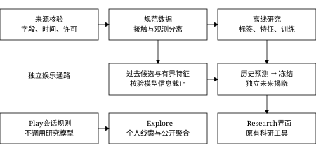
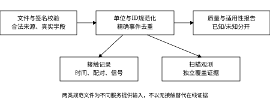
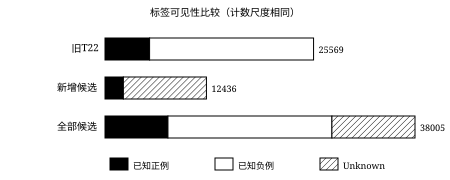
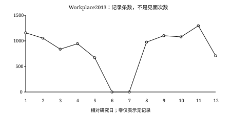
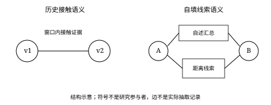
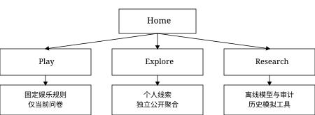

# Encounter Lab：面向未来24小时接触事件预测的数据分析、机器学习建模与交互式可视化系统设计与实现

Encounter Lab: Design and Implementation of a Data Analytics, Machine Learning and Interactive Visualization System for 24-Hour Contact Prediction

报告类型：完整项目研究报告

审阅与编制日期：2026年10月13日（第一版）；2026年10月28日（第二版，补充第11章）

项目版本：research-v2.2，478a320c0a8146cf8dfdcbb8c0d93b16640b8594

材料范围：T01-T34、补充研究T35-T40、Product Extension P01-P03及已完成文档维护。第二版在第一版基础上新增第11章，原第11章结论顺延为第12章，其余章节保持第一版原文，文中的文件路径指第一版（478a320）时的位置。作者、学校、导师与发表信息未提供，不作推定。

## 中文摘要

人与人的接触记录具有时间依赖、网络依赖和观测缺失，因而未来接触预测不能简化为对静态表格的随机分类。本文对Encounter Lab已完成项目进行证据驱动的综合审查，研究如何利用预测时点之前的匿名设备接触信息，估计配对在未来24小时内产生接触记录的可能性，并以交互界面展示结果与限制。系统以Copenhagen蓝牙记录为主要二分类来源，结合SocioPatterns工作场所和高中记录开展描述性网络与正接触检索；对时间单位未核实或无法取得的来源保留不可评价状态。工程实现采用规范化预处理、按时间划分并清除跨界标签、严格有界历史特征、基线与树模型、独立历史推理、概率冻结和条件结果揭晓。真实T17实验中，校准XGBoost的AP为0.381491，Brier分数为0.077673；T22在同一25,569条测试样本上，将历史窗口由1天扩展至7天，AP由0.588723变为0.691366。T30揭示扩大历史候选后标签可见性产生选择偏差，可靠子集上的较高AP不能解释为全体预测改善。系统另外交付独立规则型Play、个人与公开数据分离的Explore以及科研导航；其娱乐指数不属于经过验证的模型概率。最终基准通过500项完整测试，并具备页面、安全与冻结材料检查。第二版补充的滚动起点重评估把测试日扩展到11天，7天XGBoost合并AP为0.662，比1天高0.090；不用标签的Hawkes过程达到0.629，留出参与者后模型仍保持0.651。本文认为该项目形成了从数据诊断到结果审计的完整实践，但短期单一人群、仅4个主要窗口测试日、扫描代理证据和未知采集到达时间限制了长期、跨群体及实时推理结论。

关键词：接触网络；机器学习；时间泄漏；观测缺失；可视化分析；可复现性

## 目录

目录由PDF生成器根据实际排版页码自动生成。Markdown按以下章节组织：第1章绪论；第2章系统需求与总体架构；第3章数据来源与预处理；第4章预测任务与特征工程；第5章模型与实验设计；第6章实验结果与评估；第7章网络分析与可视化；第8章交互系统；第9章测试与工程质量；第10章讨论与未来工作；第11章补充研究；第12章结论；参考文献；附录A-G。

## 第1章 绪论

### 1.1 研究背景

接触模式既反映日常活动中的重复规律，也包含偶然变化。匿名传感记录可用于研究群体中的时序连接，但“记录到两台设备接近”与“确认两个人进行了交流”并不等价。Copenhagen研究公开了多层交互数据，为分析此类问题提供了可检查的材料[1-2]。本项目选择设备接近作为可操作目标，避免把日常语言中的见面、友谊或关系意图直接作为未经测量的标签。

工程上，接触数据同时面临规模与质量问题：大量原始记录可能包含同一次扫描的不同表达，未记录事件也可能来自设备缺测。如果仅追求训练成功或更高分数，容易通过随机切分、补造负例或改变候选集合获得误导结果。Encounter Lab的主要价值在于把这些问题贯穿到数据下载、特征计算、模型管理、结果展示和公开测试中，而不是只提供一个分类器调用示例[12-18]。

### 1.2 研究问题

给定来源命名空间d、预测时点t和规范配对(a,b)，系统使用t之前可确认的信息构建输入，预测未来区间(t,t+24h]内是否出现合法研究设备接触记录。配对键必须包含数据源，且a与b不同；不同来源中相同数字不代表同一人。观测不足时，结果可以为Unknown，不能强制压成二分类负例。

本文讨论三个相互区分的问题：一是在覆盖策略允许的离线总体中，模型能否形成排序和概率估计；二是在预测时只能知道过去信息时，模型如何接受输入并拒绝时间不合规请求；三是面向非技术读者，怎样解释数据、模型和娱乐规则的区别。第三个问题不提供对真实个人未来见面的统计验证。

### 1.3 研究目标

项目目标包括建立可追溯的数据准备流程、刻画1/3/7天历史预算的作用、提供保存模型的历史预测模拟，以及审计标签缺失对评估的影响。工程目标是让新克隆能够运行公开测试与聚合分析，而真实数据和权重留在合法本地环境。产品目标是给出易用的解释入口，且不把研究参与者与用户自填问卷连接起来。

### 1.4 研究意义

方法上，项目将“模型好不好”分解为目标是否可测、候选是否由过去产生、输入是否真的有界、标签是否可靠以及评价是否代表目标人群等问题。实践上，失败诊断、较差基线和性能回退也被保留，形成可复核而非单向展示的开发记录。其可解释性首先是证据与处理规则可追溯，不等于证明特征具有因果作用。

### 1.5 报告结构与审查范围

第2至5章说明系统、数据、特征与实验；第6、7章分析指标、选择偏差和网络；第8、9章讨论产品及工程验证；最后给出限制与结论。本文以478a320为审查基准，结合关键源码、公开JSON/CSV、原始阶段报告和实际CI日志交叉核对[12-21]。本次执行不重新训练，也不将公开聚合对账表述成独立原始数据复现。

## 第2章 系统需求与总体架构

### 2.1 功能与非功能需求

科研功能覆盖来源核验、数据清洗、标签与特征、时序切分、模型训练、概率评估、历史网络和实验报告。交互功能包括历史时点选择、预测冻结、独立揭晓以及来源状态说明。非功能需求强调输入版本一致、失败状态明确、私有文件不进入Git、刷新不重复执行昂贵研究作业，以及无私有数据时可验证公开项目[18-19]。

### 2.2 技术选型及职责

Python将数据处理、训练和页面整合在同一工程内。pandas与NumPy负责分组及数值计算；PyArrow/Parquet支撑按列、分块和时间条件读取。scikit-learn提供预处理、逻辑回归、校准与指标；XGBoost用于已报告的主要树模型，LightGBM保留注册与原生能力。Streamlit提供页面和状态，Plotly绘制交互图，NetworkX处理历史邻居关系和小型图布局[5-11]。

选型依据是职责互补和现有依赖复用，并非宣称这些库在所有场景最优。尤其不能将支持某模型的工程接口等同于完成该模型在真实队列上的实验。requirements与平台记录是软件环境证据；macOS锁文件不被解释为跨平台统一锁，Linux CI通过实际安装和原生导入验证另一运行环境。

### 2.3 系统整体架构

图2-1展示来源、规范数据、离线研究和推理展示之间的关系。离线特征与标签可以按键对齐，但未来覆盖证据不属于模型输入。历史模拟从原始规范记录重新产生过去候选，独立于已根据未来质量筛选的评估银行。Play则是另一条会话内规则通路，未调用Copenhagen模型。



图 2-1 系统整体架构

图中箭头表示已实现模块间的数据或调用关系，属于源码归纳的结构图，不是实际网络测量。双通路安排使系统可以同时展示科研证据和娱乐解释，而不暗示两者共享标签或概率有效性。

### 2.4 模块关系与数据流

loader和dataset_catalog验证字段、时间、来源与命名空间；preprocessing写入接触、观测及质量报告。label_builder与window_features分别生成未来目标和过去输入；temporal_split与model_registry负责隔离及持久化。asof_inference、time_machine和snapshot_manager构成独立推理服务，final_audit读取聚合证据进行只读检查[12]。

### 2.5 前后端交互

页面调用明确服务接口，展示返回值而非在界面里重写训练或计分公式。研究任务由主动按钮触发，默认首页不扫描全部数据。Time Machine状态依次为选择、预测、冻结、揭晓；UI状态改变会使旧预测失效。原生导航注册全部路由，再由四个一级入口组织访问，因此整理导航未删除旧研究能力[19]。

### 2.6 工程组织与开发过程

根目录保留规范、任务、进度和交付说明，src存放领域模块，pages存放展示入口，tests覆盖边界与集成，reports仅公开精确白名单内的聚合材料。T01-T16完成工程基础，T17完成首个真实实验，T18-T27建立窗口研究和来源诊断，T28-T34补齐推理、审计、优化与验收，P01-P03实现产品扩展。阶段编号代表工作顺序，不代表指标在同一总体上持续提高。

## 第3章 数据来源与数据预处理

### 3.1 来源核验与统计口径

数据进入研究前，需要确认官方链接、文件清单、许可、字段、时间单位和本地校验值。Copenhagen来源以Figshare发布记录及论文为依据；SocioPatterns通过实际数据页与项目来源证据核验[1-4]。本文只读取现有材料，不重新下载数据，也不把历史访问失败推断为许可限制。各来源之间不合并身份或直接混排模型性能。

统计时区分原始行、规范接触记录、唯一配对、参与者和配对-时点样本。一次连续相遇可产生多个采样记录，同一配对也可在多日形成多个预测样本。因此，数百万行不能等同于数百万次独立见面，样本数也不能被用作独立试验数来计算过度精确的不确定性。

### 3.2 Copenhagen主要来源

已验证主文件bt_symmetric.csv为98,257,835字节。T17诊断记录5,474,289原始行，其中2,426,279为有效研究设备接触；706个ID有观测记录，692个ID参与研究接触。时间0至2,418,900为相对秒，跨度27.996528天，涉及28个Study Day[13]。本项目没有据此推断未确认的公历起点、星期或实时数据日期。

蓝牙采用五分钟时间粒度，并包含未发现邻居及外部设备哨兵记录。2,220,136条空扫描和827,874条外部设备记录不属于研究配对接触，但对可观测性有意义。主实验未事后设置RSSI距离阈值；真实文件中的4条正RSSI记录沿原协议保留，不能因看过分数后删除异常而改变冻结结果。

### 3.3 SocioPatterns与其他来源

表3-1按既有T17/T31材料汇总来源能力。High School与Workplace的接触记录可以支持描述性网络，但缺少独立连续在线日志，不能仅凭未出现接触构造可靠负例。MIT处理档案的整数tick缺少真实单位映射，原研究跨度不能直接作为该处理文件的时间单位。Social Evolution保持未取得可用数据的状态[16]。

表 3-1 数据来源、实际规模与研究适用性

<!-- TABLE:SOURCE_TABLE -->
| 来源 | 参与者 | 规范接触记录 | 唯一配对 | 时间跨度 | 适用性 |
| --- | --- | --- | --- | --- | --- |
| Copenhagen | 692（接触） | 2,426,279 | 79,530 | 27.997天 | 覆盖策略下二分类 |
| Workplace2013 | 92 | 9,827 | 755 | 11.431天 | 描述与正检索 |
| Workplace2015 | 217 | 78,249 | 4,274 | 11.499天 | 描述与正检索 |
| High School2013 | 327 | 188,508 | 5,818 | 4.208天 | 描述与正检索 |
| MIT处理档案 | 96 | 27,572 | 2,539 | 单位/来源未核实 | 仅拓扑 |
| Social Evolution | 未取得 | 未取得 | 未取得 | 单位/来源未核实 | 不可用 |
<!-- /TABLE:SOURCE_TABLE -->

表中MIT的1,086,403原始有效记录与27,572规范唯一事件属于不同去重层级，不是互相矛盾的计数。Workplace两来源各只有3个完整7天比较时点；High School不足7天。来源规模并不决定能否进行二分类，是否有负例观测证据和足够时间支持更加关键。

### 3.4 字段与规范化表示

Copenhagen蓝牙记录包含时间、两端ID和RSSI；SocioPatterns接触记录包含时间、两端ID及其来源允许的元数据。规范处理后保留来源身份、相对事件时间、规范无向配对和可用信号；观测记录单独保存扫描证据。原始列与规范列的映射由适配器确认，不为未知来源虚构通讯、定位、星期或在线状态。

图3-1概括从来源校验到两类规范文件的预处理过程。接触与观测分别保存，使历史输入、未来标签与覆盖审查可以按各自边界读取，而不把无记录误作在线负例。



图 3-1 数据预处理与接触观测分离

### 3.5 质量检查

检查包括解析失败、字段数量、ID合法性、自接触、重复、时间范围、源校验值和输出版本一致性。元数据不能替代文件内容验证；缓存仅在来源签名和处理契约匹配时复用。对无法确认的单位或模式，系统保留未知或拒绝研究动作，比强行产生一个形式完整的数据表更能维护目标定义。

### 3.6 清洗与去重

有效参与者ID参与规范配对，自接触和非法配对被排除。重复消除以明确的规范事件键为依据，而非把同一配对不同时间记录都删掉。T31新研究对精确的时间-配对重复只计一次，但不修改此前原始文件或T17/T22冻结处理结果；这种版本隔离使历史统计不因新增探索被悄然重写。

### 3.7 缺失与扫描覆盖

Copenhagen一天预期288个五分钟bin，覆盖率用有效观测bin数除以288构造；实际逻辑依赖规范观测数据。扫描记录包含代理性质：对称化记录、他端发现和空扫描都不等价于连续在线证明。未来两端覆盖均达阈值且完整预测区间没有接触时，才允许负结果；不足者保持Unknown。

### 3.8 数据隐私与公开边界

原始数据、模型权重、逐样本标签及预测保存在本地忽略目录。公开材料仅包含已审查聚合信息和结构示意，不导出个体研究网络截图。匿名数字ID仍可能存在再识别风险，不能称为形式匿名保证；小分组抑制也不构成完整隐私证明。数据许可与项目代码许可分别处理，不能以网页软件页脚替代数据许可。

### 3.9 初期零样本的原因与解决

T17诊断发现原先缺少Copenhagen主蓝牙文件，而High School只有4.21天、3个完整日级快照。其10,742条候选样本包含4,023个观测正标签与6,719个Unknown，但覆盖过滤后为0；即使忽略覆盖，严格时间清除也会使训练或验证不足。提高快照频率不创造独立研究日，因此没有通过降低标准制造实验。经授权获取完整Copenhagen后，原0.5覆盖门槛及隔离规则保持不变，才具备真实实验条件[13]。

## 第4章 预测任务定义与特征工程

### 4.1 样本与目标

一个样本是(d,t,a,b)，而不是一条原始蓝牙记录。设E为合法接触事件集合，若存在s满足t<s<=t+86400且配对为(a,b)，观测标签为1；若没有此事件且未来窗口完整、扫描充分，则为0；其余为Unknown。离线主评估还要求覆盖准入，即使某正事件已被观测，也可能因覆盖不足不进入主队列[13-15]。

### 4.2 预测时点和观察窗口

主要离线协议每天08:00生成快照。研究窗口采用[t-w×86400,t)，标签采用(t,t+86400]；t及以后事件不进入输入，t本身也不属于未来目标。图4-1明确左右边界，防止把“过去一天”误写为包含预测瞬间。时间边界是计算契约，不只是图表说明。


图 4-1 历史窗口与未来标签时间轴

同一t的1/3/7天窗口嵌套，但所有特征必须各自重算。窗口更长意味着允许更多历史输入，不意味着可以提前使用下一日扫描覆盖来选择推理候选。

### 4.3 候选配对构造

T17的Known Pair来自t之前已出现的全部历史配对。T19-T22固定为前1天存在接触的共同候选，并要求完整7天来源跨度及未来可评价性，从而让不同窗口共享键、标签与切分。T28推理则直接从[t-1d,t)生成候选，不能读取按未来覆盖筛选后的银行来决定当前能够预测谁[14-15]。

这一区别回应了离线评估与实际推理的目标差异。离线需要一个明确、可评价的比较总体，推理则只能依赖过去可知信息。完整来源跨度只是档案时间容量，并不能保证参与者在7天内持续被扫描；它与覆盖质量是两个不同条件。

### 4.4 标签与覆盖准入

主协议采用两端最低扫描覆盖率0.5；0.25和0.75曾用于计数敏感性或独立策略测试，不能通过测试分数重新选择。T29-FIX从模型核验契约读取门槛，统一揭晓要求多窗口模型策略一致；实际门槛写入冻结记录并纳入完整性校验。无接触且两端未来覆盖0.4时，0.25策略可判No Contact，0.5或0.75策略应Unknown；这些是合成边界测试，不是新增真实研究结果。

### 4.5 接触频率与活动特征

window_features提供15项中性特征，表4-1列出其分组与含义。记录数、不同bin数和活跃日数不能混称为见面次数。个体活动量分别累计两端参与记录；它们反映被测活动强弱，而非社会性或因果倾向。既有滚动桶从t向过去锚定，不能用日历日期近似替换后仍宣称定义相同。

表 4-1 有界历史特征分类及含义

| 分类 | 实际字段 | 定义与缺失处理 |
| --- | --- | --- |
| 配对记录 | pair_contact_count、pair_contact_bins、pair_contact_days | 窗口内记录数、不同采样bin数、不同研究日数 |
| 最近接触 | recency_seconds | t减窗口内最后接触时间；无记录为null |
| 信号强度 | rssi_mean、rssi_max | 窗口内可用RSSI均值及最大值；不可得为null |
| 个体活动 | participant_a_activity、participant_b_activity | 各端参与的窗口内接触记录数 |
| 历史网络 | common_neighbors、network_degree_a、network_degree_b | 窗口图中的共同邻居数及两端度数 |
| 过去观测 | scan_coverage_a、scan_coverage_b、observed_history_days | 同一历史窗口的扫描占比及充分观察桶数 |
| 历史概率 | historical_contact_probability | 充分观察24小时桶中有该配对正接触的比例；分母为0时null |

### 4.6 最近接触时间

recency_seconds只检索选定窗口，计算t减最后事件时间。若窗口里没有记录，即使更早历史曾出现接触，也不能从窗口外取回最近值。这是有界预算与传统全历史特征最容易混淆的部分；截断较老列名而保留全历史recency，并不构成严格1天输入。

### 4.7 网络特征

在窗口历史图G_w中，节点表示该来源的研究设备，边表示窗口内存在接触。度数为邻居集合大小，共同邻居数为两个邻居集合交集大小。图只能由过去窗口构建；先用整个档案形成网络再计算过去节点特征，会把未来结构泄漏到模型。网络指标是统计描述，不证明朋友关系。

### 4.8 1、3、7与14天的不同角色

14天属于T17旧特征银行；T22正式信息预算比较只含1/3/7天。历史概率可记为充分观测桶内正接触桶数除以充分观测桶数，分母为0则未知。因为1天候选本来就有前一日接触，1天频率在覆盖充分时易退化为1，造成极端概率；项目公开其差表现，而不事后改规则消除难看结果[14]。

### 4.9 时间泄漏与自动拒绝

#### 4.9.1 输入边界

标签、future coverage、eligible_for_evaluation和离线银行成员资格都不属于推理输入。测试改变t及之后的接触、观测或未来来源终点，要求候选、特征与重新生成的历史概率保持不变；改变合法历史则允许输出变化。缺失数据不能通过读取未来来补齐。

#### 4.9.2 模型信息截止

除输入时间外，模型本身也有信息时间。训练、验证、校准和阈值选择使用的标签窗口终点必须全部严格早于t。命名空间、时间原点、24小时目标、有界特征策略、窗口及校验和均需一致；来源未知、错误窗口或截止时间冲突即拒绝。把未来拟合的模型放回过去，同样构成泄漏。

### 4.10 事件时间与到达时间

历史盲回放模拟事件时间上的过去可用信息，但没有采集日志时，无法证明记录在当时已经到达服务器。prospective_inference还要求可信时钟锚点和两端近期扫描；多年以前的静态Copenhagen档案不能被标为实时未来预测。这一限制不会因文件下载时间或mtime更新而消失。

## 第5章 机器学习模型与实验设计

### 5.1 模型选择依据

接触任务具有非线性、缺失及类不平衡，适合先比较简单先验、历史频率、线性模型与树提升模型。选择这些方法的目的，是识别复杂模型相对于基本重复接触规律提供了什么，而不是默认树模型必然最好。T17真实实验至少完成常数、历史频率、逻辑回归和XGBoost，窗口研究报告三类模型[13-14]。

### 5.2 基线方法

ConstantProbability仅用训练标签均值作为所有样本概率，不以测试正例率拟合。HistoricalPairFrequency读取过去历史概率，未知时回退到训练先验，并裁剪到[0,1]。TimeBasedRule与RandomForest在注册器中有实现，但不属于本报告T17/T22主要真实对比行；不为它们补造分数。

### 5.3 逻辑回归

逻辑回归以p=1/(1+exp(-eta))映射线性得分，eta为截距与特征线性组合。实际管道先按训练数据进行中位数插补并增加缺失指示，再标准化和拟合分类器；全空训练列被剔除，不从验证或测试估计插补值。T17将最大迭代次数设为2000。系数可解释为该模型条件下的线性关联，但不是接触原因或社会影响的因果估计[7,12]。

### 5.4 XGBoost

XGBoost通过逐步叠加树预测残差结构，并具有正则化与稀疏输入处理能力[5]。项目的真实协议固定随机种子42、200棵树、深度4、学习率0.05，使用二元logistic目标及Log Loss训练评价，未进行测试集网格搜索。模型配置在读取最终测试分数前固定；本报告解释已发生实验，不提出新参数竞赛。

### 5.5 LightGBM的能力边界

LightGBM是另一种梯度提升树实现，其经典工作关注大规模学习效率[6]。项目已注册其构造、持久化及原生库测试，统一设置确定性选项和单进程线程预算。但T17与T22公开主实验并没有LightGBM真实结果行，因此本文只说明工程支持，不写成已经训练并优于XGBoost的科研成果。

### 5.6 时间切分与跨界清除

样本按唯一预测时点排序，按60/20/20分配时段。设下一集合开始时间为b，前集合仅保留t+24h<b的样本；等号也被剔除。这样训练标签不能触及验证起点，验证标签不能触及测试起点。随机打散配对-日行会把相邻时期和重复配对混在两侧，不符合本任务的时间推断目标。

表 5-1 两项正式训练设计的样本与时间支持

<!-- TABLE:SPLIT_TABLE -->
| 实验 | 集合 | 样本数 | 正例 | 负例 | 时点数 |
| --- | --- | --- | --- | --- | --- |
| T17 | 训练 | 269,757 | 30619 | 239138 | 15 |
| T17 | 验证 | 155,368 | 18289 | 137079 | 4 |
| T17 | 测试 | 260,170 | 26594 | 233576 | 6 |
| T22 | 训练 | 54,677 | 11,202 | 43,475 | 11 |
| T22 | 验证 | 14,816 | 1,794 | 13,022 | 3 |
| T22 | 测试 | 25,569 | 5,467 | 20,102 | 4 |
<!-- /TABLE:SPLIT_TABLE -->

T17外层清除84,332行。T19-T22从100,485条可评估共同样本中清除5,423行，分别来自边界日19和23；保留样本并非恰好满足按行数60/20/20，因为比例作用于时点。行数庞大不抵消研究日期较少这一事实。

### 5.7 参数、阈值与模型选择

分类阈值通过验证集F1选择，平局依既定规则靠近0.5；不寻找测试最优阈值。T22固定同一候选、标签、切分、种子及参数预算，仅改变历史窗口。3天是预设中间对照，非从测试分数挑出的最佳窗口。已暴露的T17日期与后续窗口研究存在重叠，所以不能把它称为全新的外部独立验证。

### 5.8 概率校准

T17按预声明支持条件用早段验证拟合sigmoid，后段验证选阈值，并保持24小时隔离。实际校准为35,666行、1个时点；阈值选择为81,830行、2个时点。T22仅3个验证日，无法同时支持独立校准和足够后段调参日期，因此统一不拟合校准器。校准可改善概率误差，但不是必然提高排序或分类F1[8,13]。

### 5.9 模型保存与加载

模型记录包含参数、特征白名单、窗口、种子、阈值、环境和校验身份。保存后检查加载概率是否一致；推理加载还要验证来源、时间原点及信息截止，不能仅凭文件名选择权重。校准后概率与基础树raw margin属于不同量，原生TreeSHAP只能解释后者，不能直接宣称解释了校准概率。

### 5.10 复现与模型管理

旧报告、源码哈希、输入校验值和私有产物清单共同构成复现链。公开聚合审计检查数值关系，匹配的本地保存样本允许重算指标，独立从原始数据重建则是更高层次。本文不运行可能覆盖T17聚合输出的旧重拟合入口，避免以“复现”名义修改冻结证据[18]。

## 第6章 实验结果与模型评估

### 6.1 评价指标与选择理由

项目将PR-AUC明确实现为Average Precision。按得分阈值形成精确率P_k和召回率R_k，AP=sum((R_k-R_(k-1))×P_k)，并非对PR曲线任意梯形积分[9]。AP适合观察正接触的排序，但其基准随正例率变化，且不是某个人的真实相遇概率。ROC-AUC描述随机正负样本的相对排序，单类标签时不可定义，不能补成0或1。

Precision=TP/(TP+FP)，Recall=TP/(TP+FN)，F1为二者调和平均；它们依赖分类阈值，本项目使用验证集阈值。Brier=(1/N)sum((p-y)^2)，Log Loss为二元负对数似然平均；后者会重罚置信度很高的错误，数值越小越好。概率评分与排序指标必须同时呈现，避免只挑选对模型有利的一项。

### 6.2 T17基线与主模型

表6-1和图6-1均来自T17_METRICS.json的同一冻结测试总体：260,170条样本、6个时点、正例率10.221778%。常数概率的AP等于该测试范围的正例率，但其预测概率来自训练先验；两者数值接近不能被误写为使用测试标签拟合。XGBoost的排序信号优于这些基线，而逻辑回归的概率误差不优于常数基线[13]。

表 6-1 T17同一测试总体的排序与概率损失

<!-- TABLE:T17_RANK -->
| 模型 | AP | ROC-AUC | Brier | Log Loss |
| --- | --- | --- | --- | --- |
| 常数概率 | 0.102218 | 0.500000 | 0.091897 | 0.330581 |
| 历史频率 | 0.309040 | 0.703795 | 0.083377 | 0.730760 |
| 逻辑回归 | 0.245216 | 0.652128 | 0.095737 | 0.445783 |
| XGBoost原始 | 0.381491 | 0.750717 | 0.088394 | 0.380844 |
| XGBoost校准 | 0.381491 | 0.750717 | 0.077673 | 0.278910 |
<!-- /TABLE:T17_RANK -->


图 6-1 T17同总体模型AP比较

历史频率AP为0.309040，高于逻辑回归0.245216，但Log Loss达到0.730760，说明较好的排序未必产生稳健概率。极端历史频率可在未来无接触时受到较大惩罚。图中原始及校准XGBoost的AP相同，不能因条形重合就认为校准没有作用；其主要变化发生于概率刻度。

### 6.3 分类工作点与主要结果

表6-2保留不同模型的验证阈值、Precision、Recall和F1。常数模型在所选工作点把全部样本判为正，其Recall为1而Precision只有0.102218；这不是发现了全部真实接触的实用模型，只是阈值策略下的结果。原始与sigmoid XGBoost得到相同分类集合，但阈值从原始概率刻度映射到校准刻度。

表 6-2 T17冻结阈值下的分类结果

<!-- TABLE:T17_CLASSIFY -->
| 模型 | 验证阈值 | Precision | Recall | F1 |
| --- | --- | --- | --- | --- |
| 常数概率 | 0.113506 | 0.102218 | 1.000000 | 0.185477 |
| 历史频率 | 0.230769 | 0.320484 | 0.376702 | 0.346326 |
| 逻辑回归 | 0.017183 | 0.163578 | 0.373092 | 0.227438 |
| XGBoost原始 | 0.032902 | 0.380099 | 0.417989 | 0.398145 |
| XGBoost校准 | 0.217845 | 0.380099 | 0.417989 | 0.398145 |
<!-- /TABLE:T17_CLASSIFY -->

### 6.4 同一候选总体下的窗口效应

T22测试包含25,569行、4个时点，正例5,467、负例20,102。图6-2只画这一共同总体的XGBoost AP，表6-3保留全部三类模型。1/3/7天XGBoost AP分别为0.588723、0.627494、0.691366，7天减1天为0.102644；Brier也由0.128026降低到0.109107[14]。


图 6-2 T22同队列历史窗口与XGBoost AP

表 6-3 T22共同测试总体的模型与窗口比较

<!-- TABLE:T22_METRICS -->
| 窗口 | 模型 | AP | ROC-AUC | Brier | Log Loss | F1 |
| --- | --- | --- | --- | --- | --- | --- |
| 1天 | 历史频率 | 0.209642 | 0.487299 | 0.710701 | 24.793340 | 0.352301 |
| 1天 | 逻辑回归 | 0.510617 | 0.750177 | 0.139615 | 0.444968 | 0.449699 |
| 1天 | XGBoost | 0.588723 | 0.770656 | 0.128026 | 0.415109 | 0.519121 |
| 3天 | 历史频率 | 0.332908 | 0.641837 | 0.229018 | 3.000395 | 0.320097 |
| 3天 | 逻辑回归 | 0.571497 | 0.780480 | 0.131895 | 0.424873 | 0.494850 |
| 3天 | XGBoost | 0.627494 | 0.799719 | 0.120801 | 0.394671 | 0.558957 |
| 7天 | 历史频率 | 0.519329 | 0.775063 | 0.139351 | 0.974339 | 0.507521 |
| 7天 | 逻辑回归 | 0.644780 | 0.824048 | 0.119159 | 0.389749 | 0.565251 |
| 7天 | XGBoost | 0.691366 | 0.841494 | 0.109107 | 0.360995 | 0.637301 |
<!-- /TABLE:T22_METRICS -->

增长只能解释为在这些观测时期、固定协议下较长历史带来更多排序信息。仅4个主测试日不足以证明长期稳定优越，3天也不是测试选出的最优设置。1天历史频率的Brier为0.710701、Log Loss为24.793340，暴露了候选条件与频率定义的退化，报告不能删除该行或用另一个更好规则替换。

### 6.5 概率校准的效果和支持限制

T17原始XGBoost Brier为0.088394，sigmoid后为0.077673；Log Loss从0.380844变为0.278910，10-bin ECE从0.079244变为0.010393。校准在该测试中改善了概率一致性，而AP、ROC-AUC保持相同。只有1个校准日，且验证支持有限，因此不能推断校准器在其他人群或长期时期也具有同样效果。

T22和T30使用冻结的未校准窗口模型，不能将T17校准收益直接移植为它们已实现的改进。可靠性曲线是在各自可评价总体内比较预测均值与观测比例；Unknown配对没有真实比例可用于同样校准解释。ECE又依赖分箱，不能代替完整的概率审计。

### 6.6 日期依赖与不确定性

T22的7天减1天AP差在4个主测试日均为正；删除整日的XGBoost差值范围为0.093727至0.112168。这个范围是描述性敏感性，不是置信区间。协议预先要求至少8个日块才给bootstrap区间，因此没有逐行bootstrap、p值或显著性结论。同一参与者和配对反复出现，日期之间也可能相关。

预设扩展时序折从Study Day16、19、22开始，每折测试2天，XGBoost的7天减1天AP分别为0.084520、0.086919、0.044854。它们提供时期敏感性证据，但扩展训练集互有包含，不能当作3次独立重复实验。T17曾暴露重叠日期的事实进一步限制“全新测试”的说法。

### 6.7 T30候选扩展与评估总体

T28允许从过去生成更多推理候选，T30在同一4个已公开日期对冻结模型做事后描述审计，未重新拟合或选阈值。全部历史候选38,005，共同可预测37,913，可揭晓标签27,820；二者交集27,802才是主指标分母。92个输入不合规配对中有18个可揭晓正例和74个Unknown，不能因为后来知道结果就补造当时的合法预测[15]。

表 6-4 T30候选、标签与预测分母

<!-- TABLE:T30_POPULATIONS -->
| 范围 | 样本 | 正例 | 负例 | Unknown |
| --- | --- | --- | --- | --- |
| 全部候选 | 38,005 | 7,718 | 20,102 | 10,185 |
| 旧T22 | 25,569 | 5,467 | 20,102 | 0 |
| 新增候选 | 12,436 | 2,251 | 0 | 10,185 |
| 可揭晓 | 27,820 | 7,718 | 20,102 | 0 |
| 可预测且可揭晓 | 27,802 | 7,700 | 20,102 | 0 |
<!-- /TABLE:T30_POPULATIONS -->



图 6-3 原队列与新增候选的标签可见性构成

新增12,436个候选中，10,185个Unknown，占81.90%；余下2,251个已知标签全是观察到的正例，没有已知负例。图6-3用黑白纹理区分三类状态，不用Unknown充当负类。新增可预测且可评价子集只有2,233个正例，AP=1只是单类选择机制的退化，不说明模型完美区分真实接触。

### 6.8 选择偏差与概率误差

在T30共同可靠可预测子集上，1/3/7天XGBoost AP为0.669281、0.701926、0.758930。7天AP高于T22的0.691366，但正例率也从21.38%变为27.70%；Brier反而从0.109107上升为0.128114，Log Loss从0.360995上升为0.411076。因而不能称为同一总体上的持续性能改善。

未来扫描要求使旧队列更偏向可观测对象。新增低覆盖群体中，被检测到的正事件容易成为已知标签，形成非随机可见性。旧T22重叠部分的概率和标签对账成功，支持变化来自总体与观测机制，而非新训练模型。全候选真实AP、ROC和校准仍无法从Unknown中识别。

### 6.9 误差分析及科学局限

项目按过去接触频率、过去扫描程度和研究日给出分组结果，分组定义固定于预测前。错误统计包括FP、FN和预设高置信错误，个案保留在本地，不用公开错误再调测试阈值。分组AP也必须连同正例率、样本量及Unknown率解释，不能将小分组偶然高分写成用户画像规律。

T17、T22与T30可以分别回答初步可行性、相同输入预算比较和扩展候选的选择偏差，但不能组成简单的AP增长排行榜。本文所有新表格与数据图均读取冻结公开JSON/CSV，不重新估计模型概率；小数位仅按统一展示精度四舍五入，未补造不可评价来源的指标。

## 第7章 接触网络分析与数据可视化

### 7.1 网络分析的作用

网络把接触从单配对记录提升为群体结构，使读者理解节点活动、邻居重叠与时间变化。它也提醒模型输入包含关系依赖：一个人出现于多条边，多个样本并不独立。网络展示的目标是帮助检查观察对象和解释特征，不证明接触传播方向或现实社会影响。

### 7.2 节点与边的定义

科研历史图中，节点为一个数据源中的匿名研究设备，边表示所选历史区间内存在接触证据。边权可以表示记录频率，具体图必须标明时间范围和字段。全档案图仅用于描述，不能替代预测时点的历史图。接触边不等于友谊边，也不能把有共同邻居推断为双方相识。

### 7.3 历史图构建与节点度数

构图先按来源、时间和合法配对过滤，再汇总边。度数是观测到的不同邻居数量，共同邻居来自集合交集；一个度数较低的节点可能是缺测，也可能确实接触范围小。公开T31图采用各来源独立身份；指标比较需考虑群体规模、采样长度及记录机制，不能直接判断哪一群体更“社交”。

### 7.4 多数据集描述结果

Workplace2013有92节点、755配对，Workplace2015有217节点、4,274配对，High School有327节点、5,818配对；MIT处理档案为96节点、2,539配对。数字来自规范唯一配对而非原始记录行。仅三个完整7天预测日的Workplace实验不支持显著性结论；未知tick单位的MIT不生成日级或24小时预测指标[16]。

### 7.5 正接触检索与局部网络

T31用过去频率、最近接触和共同邻居规则排序，固定K为5、10、20。只有未来实际记录的正配对作为检索目标，未观察候选保持Unknown。Capture@K=命中数/候选池内观察正例数；CaptureAll@K的分母为全部观察正例；CandidateReach衡量后者有多少进入历史候选池。它们不是二分类Precision、AP或对全部真实接触的无偏召回率。

在共同7天日期上，Workplace2013的频率Top20命中1/3/7天为31/34/35，分母147，对应Capture为0.210884/0.231293/0.238095。Workplace2015为31/35/34，分母533，对应0.058161/0.065666/0.063790。每个来源只有3个日期，排名随窗口并非必然单调；不同来源也不能与Copenhagen AP混排。

### 7.6 布局与交互设计

NetworkX用于结构和固定种子布局，Plotly负责可缩放、悬停或点击解释。科研局部图根据合法历史记录形成；P02个人图用规范排序、seed42和80次布局迭代产生稳定位置[11,19]。固定布局减轻刷新跳动，但不等价于连续可拖动的物理模拟。图例和文字必须说明边的实际证据含义。

### 7.7 真实接触活动趋势

图7-1直接读取T31_SOURCE_SUMMARY.json中Workplace2013的12个相对研究日聚合记录，总量9,827。第11日为1,296条，第6、7日为0条。零只说明公开档案该研究日没有接触记录，不能证明无人到场或没有见面，也不证明设备在线。没有核验公历映射，不将这些日期擅自命名为周末或工作日。



图 7-1 Workplace2013相对研究日接触记录量

### 7.8 黑白网络结构示意

图7-2以符号节点展示两类图的语义差异，不使用真实参与者或真实边。左侧的线表示历史接触证据的定义，右侧的线表示自填线索关联。它用于解释数据模型，不是从档案抽取的个案，也不能据此推断任何人的社交关系。



图 7-2 科研接触图与自填线索图的语义示意（非个体研究数据）

### 7.9 通俗解释与缺失展示

Explore将图表问题写成容易理解的自然语言，并在图后说明发现、依据和限制。个人因素条形图只保留实际已知Keyword，不确定项不补0；公开邻居直方图尊重小分组抑制，不从其他表反推个人信息。MIT只显示允许的静态描述，Social Evolution不生成占位曲线，避免把视觉完整误当成数据可用。

### 7.10 可视化的解释边界

布局远近通常来自显示算法，不等于地理距离或社会亲密程度；节点大小必须对应明示统计量。缺测可能改变度数、边密度和活跃趋势，因此图形可以帮助发现偏差而不能消除偏差。报告以黑线、点型与纹理区分系列，保留打印可辨性，不复制网页彩色截图或公开敏感局部网络。

## 第8章 交互式应用系统设计与实现

### 8.1 用户与独立通路

系统面向普通体验者、希望理解数据的分析用户和需要审查模型的研究人员。图8-1展示Home进入Play、Explore、Research的三条路径；研究模型和问卷规则没有共享概率接口。普通用户不需要准备原始数据，开发者可以通过科研目录访问原有处理与评估工具[19]。



图 8-1 产品导航与独立预测通路

### 8.2 Home与首次加载

首页只提供简介和三个清晰入口，不默认扫描全部原始数据、读取权重、生成特征或构建大网络。原有六项科研统计保留在Research Hub的主动打开区域，并继续调用原overview_summary计算，不用娱乐卡片取代。默认轻量展示与按需研究加载由访问步骤区分，而不是删除复杂功能。

### 8.3 Play问卷体验

七个问题覆盖关系、距离、过去30天偶遇次数、最近一次偶遇、活动区域、平时活动时间和未来约定。问卷只要求粗粒度选择，无姓名、住址、联系人上传或定位权限。关系类型用于说明，约定用于范围校验；至少三项有效历史或日常线索才允许产生指数，避免信息不足时制造精确结果。

### 8.4 Explore个人与公开分析

Explore使用“我的偶遇分析”和“真实数据中的相遇规律”两个标签。已有有效提交时默认显示个人解释，否则默认显示公开数据并为个人区提供引导。个人区消费当前提交结果；公开区读取T22/T31聚合文件并做一致性检查。小型公开数据可以被页面同时计算，但不会因此默认读取私有Parquet或模型。

### 8.5 Research科研中心

四个全局一级入口为Home、Play、Explore、Research，15个页面全部注册。Research将11个专门研究工具分为数据探索、机器学习评估和高级研究，并保留原Overview统计；加上原首页路由，共12条旧科研路由均在。报告与复现链接明确不同功能的本地材料要求，进入目录不会启动训练或下载。

### 8.6 问卷结构与校验

纯Python的Questionnaire与EntertainmentResult将机器键、分值、状态、问题说明和Keyword分开。已约定见面被判超出偶遇范围，约定未知需确认；过去频率与最近接触明显矛盾时指出字段冲突。无效、过少或过期答案不生成个人分数。修改清除旧结果及Explore状态，重新提交才形成新的有效分析。

### 8.7 固定娱乐规则

设n为已知因素数，S为这些因素的预设点数之和，指数I=floor(S/n+0.5)，要求n>=3。0-34为偏低、35-69为中等、70-100为偏高；五类因素等权，Unknown从分子和分母共同排除，已回答的真实零分仍计入。权重与边界是透明设计选择，不是从真实研究标签拟合出的最优参数。

表 8-1 Play实际计分字段与规则点数

| 字段 | 选项对应点数 | 角色 |
| --- | --- | --- |
| 历史偶遇次数 | 0次=0；1-2次=35；3-5次=70；6次及以上=100 | 计分 |
| 距离 | 同一区域=100；步行可达=75；同城较远=30；异城=0 | 计分 |
| 活动区域 | 经常相同=100；偶尔相同=55；很少=0 | 计分 |
| 活动时间 | 经常相似=100；偶尔相似=55；基本不同=0 | 计分 |
| 最近偶遇 | 24小时内=100；7天内=75；30天内=45；更早=15；从未=0 | 计分 |
| 关系类型 | 不赋点数 | 说明 |
| 未来约定 | 已约定或未确认不出指数 | 范围门控 |

### 8.8 关键词与分数解释

每个Keyword引用用户实际选项，给出方向和解释，不编造GPS、日程或共同好友。虚构测试选择步行可达、3-5次、最近7天、区域及时间偶尔重合，得到66分；仅把距离改为同一区域后为71分。该检查验证公式、状态和展示一致，不提供准确率或经验有效性证据。

### 8.9 A/B线索图谱

图中A/B为符号端点，其他节点仅来自已知Keyword；连接表示问卷字段关联，不断言真实相同活动。共同熟人范围最多形成一个自述汇总节点，不产生具体朋友且不参与指数。实际构图最多8节点12边，渲染硬上限15节点30边；A/B及汇总标记固定大小，因素标记按规则分值显示。

### 8.10 真实研究图表

公开窗口图仅比较T22同一测试总体，研究群体选择影响接触活动和邻居分组，不改变独立标明的Copenhagen窗口图。图后披露4个主测试日期、观察代理和来源限制。系统拒绝用粗粒度问卷生成小时热力图，也不把T30更高AP混入同队列窗口排行。

### 8.11 页面导航与状态管理

官方st.navigation注册路由并隐藏平铺菜单，st.page_link提供四个全局入口，st.switch_page完成按钮跳转[10]。问卷保留在当前服务器会话，页面切换不改变已提交分数；修改或重置会使旧个人分析失效。Time Machine则按模型、日期、配对、策略和数据版本使冻结状态失效，两类状态分别管理。

### 8.12 首次提示与隐私设计

欢迎使用原生弹窗，确认后正常页面切换不重复；一个小型组件仅在sessionStorage保存布尔确认标记，不存问卷答案。存储被阻止、清除或确认后立即刷新可能重复提示，标签复制也可能保留标记，因此不宣称跨标签唯一身份保证。问卷仍经Streamlit传到应用服务器处理，不能将“会话内”误称为完全不离开浏览器。

### 8.13 响应式与交互限制

P03真实浏览器采用390×844、768×1024、1440×900视口，检查卡片、问卷、结果、图表和研究目录，无页面级横向溢出[19]。图谱有焦点、恢复、悬停/点击以及触屏节点说明选择器；小屏文字仍可能相互靠近，选择器保留完整解释。这是桌面浏览器视口模拟，不是实体手机、读屏器或所有浏览器的全面认证。

## 第9章 系统测试与工程质量

### 9.1 单元测试的范围

单元测试覆盖字段与时间单位验证、候选边界、特征裁剪、缺失处理、计分门控、图谱节点与公开聚合一致性。大部分使用tmp_path合成记录或小型mock，真实实验名称的测试也不自动等同于重跑真实研究。公开测试用于检查实现是否遵守契约，不能替代数据来源审查或外部泛化评价。

### 9.2 集成测试与真实产物

合成集成流程从原始扫描到标签、特征、时间切分、模型、保存预测和评估导出，检验各模块能否衔接。另有已保存真实产物的只读验证，检查36个窗口模型对完整本地导出样本的概率一致。它需要合法且匹配的私有文件；本次报告仅执行公开审计，不把先前本地验证记录表述为本轮重新验证了全部原始采集过程[18]。

### 9.3 Streamlit页面与状态测试

AppTest覆盖15个注册路由及空数据、无模型、版本变化、先预测再冻结再揭晓等交互。导航专项显式选择现代路由执行方式，以处理测试框架每轮重置旧目录检测的问题；生产页面没有测试绕过开关。旧业务断言保留，导航重组仅调整访问步骤，不通过删除科学测试取得绿灯。

### 9.4 防泄漏与未来扰动

测试分别改变预测时点之后的接触和扫描，要求候选、特征、概率不变；合法过去数据变化则可影响输出。模型窗口不匹配、未知来源、缺扫描、未来拟合截止或未冻结揭晓必须拒绝。0.25/0.5/0.75覆盖策略在0.4/0.6观测下检查No Contact与Unknown；这些边界被验证，并未放松真实测试队列。

### 9.5 保存加载与优化一致性

模型保存后重新加载需保持概率；T32还比较候选、全部历史特征、逐样本概率、T30漏斗与指标，以及T31排序和117行聚合。缓存不保存预测概率作为跳过合规检查的捷径；每次请求仍核验来源、窗口和模型截止。相同输出并不能证明捕获了真实采集到达时间，因此快照身份与实时数据可用性仍分开披露。

### 9.6 GitHub Actions实际验收

本文审阅基准478a320的研究分支运行38130816756已直接读取状态和日志，表9-1给出实际计数[20]。随后同一提交在main通过运行38131208638的手动CI，三个Job也全部成功[21]。这些是同一个代码身份在不同分支上的验证记录，不是两次独立科研实验。后续报告文档提交还需自己的CI，不能套用历史绿灯。

表 9-1 基准478a320的研究分支CI实测记录

| Job或检查 | 实际通过数 | 日志耗时或结果 |
| --- | --- | --- |
| unit-tests完整pytest | 500 | 68.56秒 |
| streamlit-smoke | 71 | 23.43秒 |
| repository-safety测试 | 27 | 0.47秒 |
| 原生依赖导入 | 12 | 1.71秒 |
| Git-index与Gitleaks | 不以测试数表示 | PASS，51份冻结对象不变 |

完整pytest包含部分上述专项用例，不应把500、71、27、12相加宣称不同测试总量。测试耗时属于该次Linux执行，不能与其他机器耗时直接计算系统加速。工作流使用Python3.11、官方SHA固定Actions、只读权限和完整历史，未恢复研究数据或权重缓存。

### 9.7 冻结材料与仓库边界

安全扫描读取真实Git索引字节，保护44个指定聚合报告及7份根研究文档，以可信历史提交5f3be86为比较基准。当前候选不能自行重算“期望哈希”来替代冻结保护。原始数据、二进制模型、逐样本结构、超大文件及个人路径被拒绝；公开PDF和图片若不符合文本策略，必须留在本地，不能借改白名单强行上传。

### 9.8 凭据与隐私检查

固定版本并校验下载身份的Gitleaks扫描可达Git历史与精确索引，日志脱敏，并用运行时构造的惰性令牌形状验证规则能够拒绝风险。少量已核验行哈希的例外限于特定字段和值，未禁用服务商规则。该机制不构成全面DLP、不可变分支保护或形式匿名证明，未知未来敏感结构仍需人工审查。

### 9.9 浏览器验收的证据层级

P03记录了实际浏览器确认欢迎、同标签刷新、虚构问卷66至71、图谱汇总节点、A焦点与恢复、来源切换、研究入口和重置。浏览器测试未在本次编写报告时重新执行；本文引用已验收记录并保留视口模拟限制[19]。HTTP健康检查、页面元素测试和视觉检查分别回答服务存活、行为正确和布局可读，不能互相代替。

### 9.10 测试结果的解释

工程验收说明公开项目在给定环境、输入契约和用例下可运行，并保护了若干已识别风险。它不证明数据代表现实全部人群、不保证所有Unknown都无接触，也不等价于隐私认证。本文以清晰的证据分级呈现工作量：已公开可复核、既有本地验证、描述性研究和尚不可用能力分别说明。

### 9.11 性能测量与安全代价

T32在同主机、同输入、同缓存模式下，每种配置运行5个独立进程，记录中位数、范围和进程峰值RSS；共12项操作、24个冷/暖配置。表9-2仅摘录实测代表行[17]。暖特征耗时减少97.925%、暖保存模型预测减少95.003%，但冷特征与冷预测分别变慢9.262%和7.003%；不能宣传全站加速95%。

表 9-2 T32同模式代表性耗时比较

<!-- TABLE:PERFORMANCE_TABLE -->
| 操作 | 模式 | 优化前秒 | 优化后秒 | 同模式变化 |
| --- | --- | --- | --- | --- |
| 多窗口特征 | 冷 | 0.768109 | 0.839252 | -9.262%（耗时减少） |
| 多窗口特征 | 暖 | 0.767504 | 0.015926 | +97.925%（耗时减少） |
| 保存模型预测 | 冷 | 0.826240 | 0.884102 | -7.003%（耗时减少） |
| 保存模型预测 | 暖 | 0.782652 | 0.039108 | +95.003%（耗时减少） |
<!-- /TABLE:PERFORMANCE_TABLE -->

MIT冷网络峰值RSS从439.6875 MiB降至318.359375 MiB，减少27.594%；这一内存改善不能外推为所有来源均节省内存。若干暖路径的RSS也可能增加。页面准备仅测数据准备，不测完整Streamlit渲染、物理移动设备或跨操作系统；本报告不重新跑计时来替代原冻结测量。

快照绑定规范文件、模型与策略字节，活动源变化会中止，不自动重试掩盖版本不一致。缓存身份包括来源、版本、时间、窗口、特征和覆盖策略，结果在外层校验后发布。代价是校验与隔离增加冷路径开销；系统未保证对抗同权限篡改、实时多文件原子摄取、全局事务或断电持久性，最终检查至发布仍有TOCTOU限制。

## 第10章 讨论与未来工作

### 10.1 研究价值

项目把数据诊断、实验、独立推理、选择偏差和安全交付整合为一条可解释证据链。其成果既包括模型排序信号，也包括对什么不能评价的明确结论。零样本诊断和保留坏结果说明研究推进依赖目标与材料可行性，而非单纯增加算法复杂度。

### 10.2 数据与来源限制

主要二分类来源仅覆盖短期、特定人群；Workplace与High School缺少可靠负例证据，MIT时间单位未知，Social Evolution尚不可用。更多原始行并不自动增加独立日期或人群多样性。未来可以寻求合法独立来源和更长时段，但本报告没有新增下载、接入或实验来声称限制已解决。

### 10.3 历史接触与真实偶遇

蓝牙或可穿戴记录测量的是设备近距离证据，并未标记约定、偶然、交谈意愿或关系性质。Play问卷关心未提前安排的偶遇，因而目标与Copenhagen标签不同。将真实模型用于该问卷，需要独立采集合法、对应目标的验证数据；当前透明规则不能被包装为已经完成的个性化学习模型。

### 10.4 缺测与不确定性

Unknown的比例及其群体分布本身是研究结果。对它们补0会改变目标，丢弃它们又会产生选择问题。可以报告已观察正例下界和可靠子集表现，但在缺少额外观测假设或独立证据时，全体真实事件率和无偏AP不能被识别。提高数值精度或增加复杂网络特征无法消除这一识别限制。

### 10.5 跨群体泛化

第一版实验主要是同一人群内部的时间预测；第11章的T38在同一人群内留出了未见参与者，但仍不包含跨组织迁移。重复配对使模型可能利用稳定历史模式；4个主要测试日也不足以检验学期、季节和设备变化。未来研究应预先冻结更多未暴露时间块、来源和冷启动协议，再考虑显著性或外部泛化结论。

### 10.6 校准与个性化限制

概率是否接近经验频率取决于评估总体。T17的sigmoid改进不保证扩展候选或低覆盖群体也校准；娱乐规则连经验概率标定都未进行。若未来探索个性化，应事先定义可观察目标、隐私保护、充分样本和验证设计，不能利用当前报告中的已暴露测试日期反复挑选权重。

### 10.7 可能的数据采集研究

可信采集日志可以区分事件发生与到达系统的时间，独立在线记录可以改善负例证据。任何新增采集都应先核验许可、知情同意、最小化与保留期限，再设计研究。这里描述的是可能方向，既不提出绕过不可用来源，也不声称本项目已部署实时定位或长期用户追踪。

### 10.8 系统扩展方向

在新授权下可以研究更长时段、不同观测机制、更多物理设备与无障碍环境，也可以检验不同缓存安全代价。扩展应维持数据通路、模型截止、版本与冻结验证。现有工程完整性是一种可审查的基础，不是直接投入高风险个人决策的充分依据。

## 第11章 补充研究：滚动验证、更强基线与跨人群检验

### 11.1 动机与总体设计

第6章的窗口比较只有4个主要测试日，达不到预设的8天日块bootstrap门槛，也无法区分模型优势与日期偶然性。第11章汇总T35–T40六项补充研究，它们都只读第4章的冻结队列和有界特征，不改动T17–T34的冻结证据。T21/T22的模型、参数、seed和阈值规则保持不变；协议和折计划在拟合前写入哈希冻结文件；Hawkes半衰期等少量选择只在各折验证集上进行。需要说明的是，这些研究用到的测试日此前都被评估过（T17、T22 walk-forward或T21/T22主测试），因此它们是固定协议下的重评估，不是全新的留出集；日块区间只描述日间波动[22]。

### 11.2 滚动起点重评估（T35）

T35把每个预测时刻作为一个测试折：取其前3个时刻为验证集，再往前的全部时刻为训练集（至少4天），相邻集合之间严格满足t+24h早于下一集合的起点。20个队列时刻中，有11个满足条件（研究日17–27），共59,140个测试样本，正例率19.66%。表11-1列出7天窗口各模型以及1天、3天XGBoost的合并指标。按人排序指标以（预测时刻，参与者）为单位，只计至少有一个正例的单位。

表 11-1 T35滚动验证合并指标（11个测试日）

| 窗口 | 模型 | 合并AP | ROC-AUC | Brier | NDCG@5 | P@5 |
| --- | --- | --- | --- | --- | --- | --- |
| 1天 | XGBoost | 0.5716 | 0.7640 | 0.1211 | 0.7066 | 0.5219 |
| 3天 | XGBoost | 0.6120 | 0.7967 | 0.1144 | 0.7417 | 0.5484 |
| 7天 | XGBoost | 0.6619 | 0.8320 | 0.1057 | 0.7856 | 0.5827 |
| 7天 | 逻辑回归 | 0.5907 | 0.8159 | 0.1159 | 0.7804 | 0.5762 |
| 7天 | 历史频率 | 0.4762 | 0.7737 | 0.1410 | 0.7166 | 0.5362 |

7天XGBoost相对1天的合并AP差为+0.090，日块95%区间为[0.073, 0.103]，11天全部为正；相对7天逻辑回归差+0.071，11天中9天为正。"历史越长越准"和"XGBoost优于简单基线"这两个方向，在11个测试日上都稳定成立，与T22的4天结果一致。由于样本还包含T19中被清除或用作训练、验证的日期，T35与T22属于不同总体，不能直接比较两者的AP。

### 11.3 Hawkes自激过程基线（T36、T40）

为检验监督模型的优势来自哪里，T36为每个（t，配对）单独拟合指数核Hawkes过程[23]：λ(s)=μ+αβΣexp(−β(s−t_j))，求和遍及s之前的每次接触t_j，只用该配对在[t−7d,t)内的接触时间，不用任何标签，并以1−exp(−Λ)作为未来24小时至少接触一次的概率。T36的半衰期网格为0.5、2、8、24小时，每折都选中了下边界0.5小时。T40把网格扩展到5分钟，并改用log-sum-exp递推，以避免短半衰期时的数值溢出；在共有的半衰期上，新旧结果的最大差为2.6e-09。扩展后，验证集上的最优值落在15–30分钟这一网格内部。

表 11-2 Hawkes相关模型与XGBoost（7天，11个测试日）

| 窗口 | 模型 | 合并AP | ROC-AUC | Brier | NDCG@5 | P@5 |
| --- | --- | --- | --- | --- | --- | --- |
| 7天 | XGBoost+Hawkes特征 | 0.6649 | 0.8331 | 0.1050 | 0.7893 | 0.5836 |
| 7天 | XGBoost | 0.6619 | 0.8320 | 0.1057 | 0.7856 | 0.5827 |
| 7天 | Hawkes（无标签） | 0.6285 | 0.8214 | 0.1158 | 0.7836 | 0.5792 |
| 7天 | Hawkes扩展网格 | 0.6258 | 0.8217 | 0.1162 | 0.7850 | 0.5804 |

Hawkes的合并AP为0.629，比XGBoost低0.033，但按人NDCG@5几乎相同。扩展网格后AP为0.626，与T36的差异区间包含0。把4个Hawkes分数作为输入加入XGBoost（T37），合并AP只增加0.003。这三项结果共同说明：未来24小时接触的可预测信号主要来自最近接触的时间结构；监督树模型与两参数点过程只在这一结构的表达方式上略有不同。

### 11.4 留出参与者验证（T38）

时间维度已经无法提供未暴露的测试集，但"人"这个维度还没用过。T38按加盐哈希把参与者分成A、B两组，预先固定5种划分；每折只用A–A配对训练和确定阈值，再在B–B（两人都未见过）和A–B（一人未见过）配对上测试。

表 11-3 留出参与者验证（B–B配对，5种划分的均值与范围）

| 模型 | 合并AP均值 | 5种划分范围 | ROC-AUC | NDCG@5 |
| --- | --- | --- | --- | --- |
| XGBoost（仅A–A训练） | 0.6512 | 0.6311–0.6655 | 0.8294 | 0.7966 |
| XGBoost（见过全部参与者） | 0.6684 | 0.6499–0.6823 | 0.8372 | 0.8010 |
| Hawkes（无标签） | 0.6339 | 0.6092–0.6546 | 0.8240 | 0.7975 |
| 逻辑回归（仅A–A训练） | 0.5910 | 0.5585–0.6183 | 0.8185 | 0.7930 |
| 历史频率（仅A–A） | 0.4779 | 0.4589–0.4965 | 0.7787 | 0.7477 |

在B–B配对上，留出XGBoost的AP为0.651，比见过全部参与者的模型低约0.017；5种划分都在同一方向，NDCG@5几乎不变。A–A配对只占全部训练行的23%–29%，所以这个差距同时包含"未见过这些人"和"训练数据更少"两个因素，现有设计无法把两者分开。留出XGBoost相对Hawkes仍高0.010–0.025 AP，但没有一种划分的日块区间排除0，说明对陌生人群，监督模型相对点过程的优势并不稳定。

### 11.5 日间差异（T39）

同一7天XGBoost的日AP从0.43到0.91不等。T39按天描述规模、正例率以及t之前的接触结构：日AP与正例率的Spearman相关为+0.74，与平均距上次接触时间的相关为-0.86；参与者活跃度和扫描覆盖率与日AP基本无关。正例率仅5.4%的那一天，AP最低，但相对随机排序的提升倍数是11天中最高的（7.9倍）。因此，比较不同日子时应同时看AP与AP/正例率。由于星期起点未确认，本文不把任何日期标注为工作日或周末。


图 11-1 补充研究的合并AP对比

### 11.6 小结与局限

六项补充研究在不改动冻结证据的前提下，把可评估的测试日从4天扩展到11天，并加入了人群维度的留出检验和不用标签的点过程基线。结论在不同设计下保持一致：7天历史稳定优于1天；最近接触的时间结构是主要信号来源；对没见过的人，模型依然有效，代价约0.02 AP以内。但测试日都已暴露，参与者和配对跨天重复，单一人群、扫描代理标签和Unknown等限制依然存在，这些结果仍属描述性证据。

## 第12章 结论

本文基于Encounter Lab版本478a320，系统审查了T01-T34及P01-P03的研究与工程交付。项目完成真实数据诊断、合法来源管理、规范预处理、严格时间切分、有界历史特征、基线与XGBoost实验、独立历史推理、选择偏差分析、描述网络和公开CI，形成了从失败状态到结果展示的完整实现。

真实T17实验展示接触排序信号与该时期的校准收益；T22在同一25,569条样本上给出1/3/7天历史预算比较，7天XGBoost AP为0.691366。T30说明扩展候选后的可见标签存在强选择偏差，较高AP不能作为同一总体持续改进证据。T31在适合范围内保留正接触检索，T32同时报告暖路径改善和冷路径代价。

交互系统通过Home、Play、Explore和Research组织15个注册页面，保留原科研能力，并将娱乐指数、个人线索和真实群体研究隔离。500项完整测试及安全、页面和冻结检查支撑工程可验证性，而短期人群、少数测试日、扫描代理、Unknown和到达时间缺失限制了科学推广。

第二版新增的第11章在不改动冻结证据的前提下，把可评估的测试日从4天扩展到11天：7天XGBoost的合并AP为0.662，比1天高0.090，11天全部为正。不用标签的Hawkes过程达到0.629，把它作为特征加入XGBoost只再提高0.003，说明主要信号来自最近接触的时间结构。留出参与者后，模型在未见人群上的AP为0.651，代价在0.02以内。这些测试日此前都已暴露，所以上述结果仍是描述性证据。

总体而言，项目的实践价值不仅在于训练出一个模型，还在于建立明确的数据目标、可追溯实验、诚实限制和可复查交付。后续进展应以新的合法数据与预设验证为依据；本报告没有将未来计划、合成测试或产品规则写成已完成的真实预测研究。

## 参考文献

[1] SAPIEZYNSKI P, STOPCZYNSKI A, LASSEN D D, et al. Interaction data from the Copenhagen Networks Study[J]. Scientific Data, 2019, 6:315. DOI:10.1038/s41597-019-0325-x. https://www.nature.com/articles/s41597-019-0325-x.

[2] SAPIEZYNSKI P, STOPCZYNSKI A, LASSEN D D, et al. The Copenhagen Networks Study interaction data[DS/OL]. Figshare, 2019[2026-10-13]. DOI:10.6084/m9.figshare.7267433. https://figshare.com/articles/dataset/The_Copenhagen_Networks_Study_interaction_data/7267433.

[3] MASTRANDREA R, FOURNET J, BARRAT A. Contact Patterns in a High School: A Comparison between Data Collected Using Wearable Sensors, Contact Diaries and Friendship Surveys[J]. PLoS ONE, 2015, 10(9):e0136497. DOI:10.1371/journal.pone.0136497. https://journals.plos.org/plosone/article?id=10.1371/journal.pone.0136497.

[4] SOCIOPATTERNS. Contacts in a workplace; Contacts in a workplace, 2nd deployment[DS/OL].[2026-10-13]. https://sociopatterns.org/datasets/contacts-in-a-workplace/ ; https://sociopatterns.org/datasets/test/.

[5] CHEN T, GUESTRIN C. XGBoost: A Scalable Tree Boosting System[EB/OL]. 2016[2026-10-13]. arXiv:1603.02754. https://arxiv.org/abs/1603.02754.

[6] KE G, MENG Q, FINLEY T, et al. LightGBM: A Highly Efficient Gradient Boosting Decision Tree[C]. Advances in Neural Information Processing Systems, 2017, 30. https://proceedings.neurips.cc/paper_files/paper/2017/hash/6449f44a102fde848669bdd9eb6b76fa-Abstract.html.

[7] SCIKIT-LEARN DEVELOPERS. LogisticRegression[EB/OL].[2026-10-13]. https://scikit-learn.org/stable/modules/generated/sklearn.linear_model.LogisticRegression.html. 在线文档用于算法说明；项目历史参数以基准源码和环境记录为准。

[8] SCIKIT-LEARN DEVELOPERS. Probability calibration[EB/OL].[2026-10-13]. https://scikit-learn.org/stable/modules/calibration.html.

[9] SCIKIT-LEARN DEVELOPERS. average_precision_score[EB/OL].[2026-10-13]. https://scikit-learn.org/stable/modules/generated/sklearn.metrics.average_precision_score.html.

[10] STREAMLIT. st.navigation[EB/OL].[2026-10-13]. https://docs.streamlit.io/develop/api-reference/navigation/st.navigation.

[11] NETWORKX DEVELOPERS. spring_layout[EB/OL].[2026-10-13]. https://networkx.org/documentation/stable/reference/generated/networkx.drawing.layout.spring_layout.html.

[12] HILBERT-SUN. Encounter Lab项目源码及任务记录[CP/OL]. 版本478a320c0a8146cf8dfdcbb8c0d93b16640b8594[2026-10-13]. https://github.com/Hilbert-sun/Machine-Learning-Experiment-Design-Predicting-Whether-Two-People-Will-Meet-in-the-Next-24-Hours/tree/478a320c0a8146cf8dfdcbb8c0d93b16640b8594.

[13] ENCOUNTER LAB. T17 - First Genuine Real-Data Experiment; T17 - Real Data Diagnostics[R/OL]. 2026[2026-10-13]. 仓库文件reports/T17_REAL_EXPERIMENT.md、reports/T17_DATA_DIAGNOSTICS.md、reports/T17_METRICS.json；固定版本同文献[12]。

[14] ENCOUNTER LAB. T22 - 1/3/7d comparison and temporal robustness[R/OL]. 2026[2026-10-13]. reports/window_study/T22_WINDOW_COMPARISON.md、T22_ROBUSTNESS.json、T22_METRICS.csv；固定版本同文献[12]。

[15] ENCOUNTER LAB. T30 - As-of预测质量与选择偏差审计[R/OL]. 2026[2026-10-13]. ASOF_AUDIT.md、reports/asof_audit/T30_RESULTS.json、T30_METRICS.csv；固定版本同文献[12]。

[16] ENCOUNTER LAB. 多数据集探索性研究及来源质量材料[R/OL]. 2026[2026-10-13]. MULTISOURCE_STUDY.md、reports/multisource/T31_SOURCE_SUMMARY.json、T31_RETRIEVAL_METRICS.csv；固定版本同文献[12]。

[17] ENCOUNTER LAB. T32性能与快照审计[R/OL]. 2026[2026-10-13]. PERFORMANCE_AUDIT.md、reports/performance/T32_BENCHMARK.csv、T32_PARITY.json；固定版本同文献[12]。

[18] ENCOUNTER LAB. Final Research Audit及复现分级说明[R/OL]. 2026[2026-10-13]. FINAL_RESEARCH_AUDIT.md、REPRODUCIBILITY.md、FINAL_RELEASE_CHECKLIST.md、CI_VERIFICATION.md；固定版本同文献[12]。

[19] ENCOUNTER LAB. P03 Product Delivery及产品边界说明[R/OL]. 2026[2026-10-13]. PRODUCT_DELIVERY.md、PRODUCT_PLAN.md、EXPLORE_GUIDE.md；固定版本同文献[12]。

[20] GITHUB ACTIONS. Encounter Lab Public CI：research-v2.2，478a320，运行38130816756[EB/OL]. 2026-10-11[2026-10-13]. https://github.com/Hilbert-sun/Machine-Learning-Experiment-Design-Predicting-Whether-Two-People-Will-Meet-in-the-Next-24-Hours/actions/runs/38130816756.

[21] GITHUB ACTIONS. Encounter Lab Public CI：main，478a320，运行38131208638[EB/OL]. 2026-10-11[2026-10-13]. https://github.com/Hilbert-sun/Machine-Learning-Experiment-Design-Predicting-Whether-Two-People-Will-Meet-in-the-Next-24-Hours/actions/runs/38131208638.

[22] TASHMAN L J. Out-of-sample tests of forecasting accuracy: an analysis and review[J]. International Journal of Forecasting, 2000, 16(4):437-450. DOI:10.1016/S0169-2070(00)00065-0.

[23] HAWKES A G. Spectra of some self-exciting and mutually exciting point processes[J]. Biometrika, 1971, 58(1):83-90. DOI:10.1093/biomet/58.1.83.

[24] ENCOUNTER LAB. T35–T40补充研究公开聚合结果：studies/目录[EB/OL]. research-v2.2, 2026-10-28. https://github.com/Hilbert-sun/Machine-Learning-Experiment-Design-Predicting-Whether-Two-People-Will-Meet-in-the-Next-24-Hours/tree/research-v2.2/studies.

## 附录A 核心目录与阶段成果

表 A-1 工程目录的实际职责

| 目录或文件 | 职责与公开边界 |
| --- | --- |
| app.py、pages/、src/ui.py | 四入口与15路由；旧科研工具保留 |
| src/loader.py、dataset_catalog.py、preprocessing.py | 来源、字段、时间与规范处理 |
| src/window_features.py、asof_inference.py、time_machine.py | 有界输入、模型截止、独立预测冻结揭晓 |
| src/train.py、model_registry.py、evaluate.py | 训练、注册、指标和持久化 |
| reports/ | 44个审查白名单聚合报告，不含逐样本结果 |
| tests/、.github/workflows/、tools/ | 合成边界测试、Linux CI、索引与凭据检查 |
| data/、models/ | 本地合法数据、权重、私有预测及缓存，Git仅保留目录标记 |
| deliverables/ | 本报告源、证据映射与黑白SVG；PDF及渲染检查留在本地 |

T01-T16完成基础环境、数据和建模界面；T17完成真实实验；T18-T22提供冻结与窗口比较；T23-T27完成研究界面及新增来源诊断。T28建立独立推理，T29及修复形成历史机器，T30审计选择偏差，T31开展正接触检索，T32优化快照与缓存，T33部署CI，T34审计科研交付。P01-P03依次完成规则问卷、Explore和导航体验；文档维护不新增研究结论。

## 附录B 配置与环境

项目应用使用Python3.11和现有requirements.txt；requirements-lock.txt是已验证macOS ARM64环境记录，不是Linux锁。主协议为每日08:00、24小时目标、最低覆盖0.5、随机种子42；通讯与未知星期不进入真实研究。窗口模型使用bounded_window_v1和1/3/7天预算，参数、阈值及校准身份随模型保存。

本报告PDF生成使用独立的现有文档运行环境及ReportLab，不修改应用依赖；正文嵌入宋体兼容字体、标题嵌入黑体。页面为A4、四边约2.5cm、正文12pt及18pt行距，两端对齐、首行24pt。SVG只使用黑白线条、空白或纹理，图表数字读取公开来源；没有复制网页截图。

## 附录C 指标与解释规则

表 C-1 主要指标的有效范围和用途

| 指标 | 更优方向 | 解释约束 |
| --- | --- | --- |
| AP | 较大 | 正例排序，基准随正例率；不是个体概率 |
| ROC-AUC | 较大 | 正负排序，单类目标不定义 |
| Precision、Recall、F1 | 依目标权衡 | 依赖验证阈值；不在测试优化 |
| Brier、Log Loss | 较小 | 概率质量，Log Loss对极端错误更敏感 |
| ECE | 较小 | 分箱条件下校准误差，须说明分箱 |
| Capture@K | 较大 | 已观察候选内正例检索，不是二分类Precision |
| Unknown率 | 不是模型优劣分数 | 反映可评价性与选择机制 |

## 附录D 主要结果补充

表 D-1 T22共同队列XGBoost完整分类与概率指标

<!-- TABLE:T22_XGB_COMPLETE -->
| 窗口 | AP | ROC-AUC | Brier | Log Loss | Precision | Recall | F1 |
| --- | --- | --- | --- | --- | --- | --- | --- |
| 1天 | 0.588723 | 0.770656 | 0.128026 | 0.415109 | 0.603148 | 0.455643 | 0.519121 |
| 3天 | 0.627494 | 0.799719 | 0.120801 | 0.394671 | 0.643180 | 0.494238 | 0.558957 |
| 7天 | 0.691366 | 0.841494 | 0.109107 | 0.360995 | 0.680299 | 0.599415 | 0.637301 |
<!-- /TABLE:T22_XGB_COMPLETE -->

表 D-2 T30共同可靠可预测子集XGBoost指标

<!-- TABLE:T30_XGB_COMPLETE -->
| 窗口 | AP | ROC-AUC | Brier | Log Loss | Precision | Recall | F1 |
| --- | --- | --- | --- | --- | --- | --- | --- |
| 1天 | 0.669281 | 0.785495 | 0.150793 | 0.472404 | 0.692380 | 0.479091 | 0.566319 |
| 3天 | 0.701926 | 0.812506 | 0.142075 | 0.449366 | 0.725055 | 0.513377 | 0.601125 |
| 7天 | 0.758930 | 0.854281 | 0.128114 | 0.411076 | 0.754738 | 0.615455 | 0.678017 |
<!-- /TABLE:T30_XGB_COMPLETE -->

T17各模型及阈值见表6-1、6-2；T31三个完整共同日期的频率Top20见7.5节；T32代表性冷/暖测量见表9-2。它们的来源、分母和单位不同，不合并为单一总榜。本报告配套校验清单记录每个输入文件的SHA256及表图取值来源。

## 附录E 运行与复现

公开代码验证先安装现有环境，再执行以下只读或合成测试命令。运行这些命令不表示已取得真实数据或完成原始采集复现：

```sh
python -m pip check
python -m pytest -q
python -m src.final_audit
python tools/check_repository_safety.py
python -m tools.run_secret_scan
python -m streamlit run app.py
```

本地真实保存产物齐备时，可按REPRODUCIBILITY.md运行window_verify或asof_audit --verify-only，核对冻结模型概率和已有私有样本。不要运行会覆盖T17报告的重拟合入口，不用替换输入冒充相同版本。报告生成器只读公开JSON/CSV与Markdown，可重建SVG/PDF；字体与排版依赖由本地文档环境提供，二进制成品不加入Git。

## 附录F 完整用户操作路径

普通用户从Home进入Play，确认未安排见面，填写粗粒度历史与日常线索，提交后阅读整数指数、倾向与实际关键词。进入Explore查看同一结果与图谱；通过节点说明控件查看来源，通过修改回到表单，重新提交更新。重置清空问卷与可选关系状态，没有问卷时个人区显示引导。

分析用户直接打开Explore公开标签，阅读固定Copenhagen窗口比较和各来源活动/邻居分组。切换来源时注意MIT时间单位及Social不可用状态；公开图不表示用户本人生活。研究用户从Research目录进入数据、模型或高级工具，按本地材料要求操作。Time Machine使用历史研究日，先Predict、再Freeze、最后明确Reveal；证据不足时接受Unknown，不将档案称为实时预测。

## 附录G 已知限制与证据追溯

表 G-1 需要持续保留的限制

| 类别 | 目前已知限制 |
| --- | --- |
| 研究总体 | 短期同人群，重复配对，T22只有4个主测试日 |
| 观测 | 扫描覆盖为代理，Unknown不可识别，接触不等于交流 |
| 实验 | T17/T22/T30总体不同；日期已暴露；无长期显著性证明 |
| 新来源 | Contact-only缺负例，MIT tick未知，Social未取得 |
| 产品 | Play规则无真实概率验证；线索图不是真实社交图 |
| 工程 | 快照有TOCTOU与摄取限制；冷校验有成本；CI不是原始复现 |
| 界面 | 三档视口模拟，未认证实体设备、全面读屏器或跨浏览器 |

对本报告进行核验时，先查看EVIDENCE_MAP.md确定章节与源码、报告的对应关系，再用REPORT_VERIFICATION.json核对来源哈希、表图计数和实际版面检查。输入版本478a320是编写时的已验收工程基准，后续报告提交只增加文档与排版材料；其独立GitHub CI链接由交付回执提供。未提供的机构、导师、个人学术身份和发表信息均未填写。
