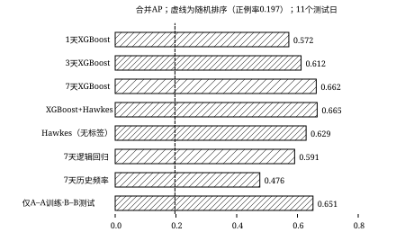

## 第11章 补充研究：滚动验证、更强基线与跨人群检验

### 11.1 动机与总体设计

第6章的窗口比较只有4个主要测试日，达不到预设的8天日块bootstrap门槛，也无法区分模型优势与日期偶然性。第11章汇总T35–T40六项补充研究，它们都只读第4章的冻结队列和有界特征，不改动T17–T34的冻结证据。T21/T22的模型、参数、seed和阈值规则保持不变；协议和折计划在拟合前写入哈希冻结文件；Hawkes半衰期等少量选择只在各折验证集上进行。需要说明的是，这些研究用到的测试日此前都被评估过（T17、T22 walk-forward或T21/T22主测试），因此它们是固定协议下的重评估，不是全新的留出集；日块区间只描述日间波动[22]。

### 11.2 滚动起点重评估（T35）

T35把每个预测时刻作为一个测试折：取其前3个时刻为验证集，再往前的全部时刻为训练集（至少4天），相邻集合之间严格满足t+24h早于下一集合的起点。20个队列时刻中，有11个满足条件（研究日17–27），共59,140个测试样本，正例率19.66%。表11-1列出7天窗口各模型以及1天、3天XGBoost的合并指标。按人排序指标以（预测时刻，参与者）为单位，只计至少有一个正例的单位。

表 11-1 T35滚动验证合并指标（11个测试日）

{{T35_TABLE}}

7天XGBoost相对1天的合并AP差为{{D71}}，日块95%区间为{{D71_CI}}，11天全部为正；相对7天逻辑回归差{{DLR}}，11天中9天为正。"历史越长越准"和"XGBoost优于简单基线"这两个方向，在11个测试日上都稳定成立，与T22的4天结果一致。由于样本还包含T19中被清除或用作训练、验证的日期，T35与T22属于不同总体，不能直接比较两者的AP。

### 11.3 Hawkes自激过程基线（T36、T40）

为检验监督模型的优势来自哪里，T36为每个（t，配对）单独拟合指数核Hawkes过程[23]：λ(s)=μ+αβΣexp(−β(s−t_j))，求和遍及s之前的每次接触t_j，只用该配对在[t−7d,t)内的接触时间，不用任何标签，并以1−exp(−Λ)作为未来24小时至少接触一次的概率。T36的半衰期网格为0.5、2、8、24小时，每折都选中了下边界0.5小时。T40把网格扩展到5分钟，并改用log-sum-exp递推，以避免短半衰期时的数值溢出；在共有的半衰期上，新旧结果的最大差为{{PARITY}}。扩展后，验证集上的最优值落在15–30分钟这一网格内部。

表 11-2 Hawkes相关模型与XGBoost（7天，11个测试日）

{{HAWKES_TABLE}}

Hawkes的合并AP为{{HAWKES_AP}}，比XGBoost低{{XGB_HAWKES}}，但按人NDCG@5几乎相同。扩展网格后AP为{{WIDE_AP}}，与T36的差异区间包含0。把4个Hawkes分数作为输入加入XGBoost（T37），合并AP只增加{{T37_DELTA}}。这三项结果共同说明：未来24小时接触的可预测信号主要来自最近接触的时间结构；监督树模型与两参数点过程只在这一结构的表达方式上略有不同。

### 11.4 留出参与者验证（T38）

时间维度已经无法提供未暴露的测试集，但"人"这个维度还没用过。T38按加盐哈希把参与者分成A、B两组，预先固定5种划分；每折只用A–A配对训练和确定阈值，再在B–B（两人都未见过）和A–B（一人未见过）配对上测试。

表 11-3 留出参与者验证（B–B配对，5种划分的均值与范围）

{{HOLDOUT_TABLE}}

在B–B配对上，留出XGBoost的AP为{{HOLDOUT_AP}}，比见过全部参与者的模型低约{{HOLDOUT_GAP}}；5种划分都在同一方向，NDCG@5几乎不变。A–A配对只占全部训练行的23%–29%，所以这个差距同时包含"未见过这些人"和"训练数据更少"两个因素，现有设计无法把两者分开。留出XGBoost相对Hawkes仍高0.010–0.025 AP，但没有一种划分的日块区间排除0，说明对陌生人群，监督模型相对点过程的优势并不稳定。

### 11.5 日间差异（T39）

同一7天XGBoost的日AP从{{DAY_MIN}}到{{DAY_MAX}}不等。T39按天描述规模、正例率以及t之前的接触结构：日AP与正例率的Spearman相关为{{RHO_PREV}}，与平均距上次接触时间的相关为{{RHO_REC}}；参与者活跃度和扫描覆盖率与日AP基本无关。正例率仅5.4%的那一天，AP最低，但相对随机排序的提升倍数是11天中最高的（{{LIFT_MAX}}倍）。因此，比较不同日子时应同时看AP与AP/正例率。由于星期起点未确认，本文不把任何日期标注为工作日或周末。

图 11-1 补充研究的合并AP对比

### 11.6 小结与局限

六项补充研究在不改动冻结证据的前提下，把可评估的测试日从4天扩展到11天，并加入了人群维度的留出检验和不用标签的点过程基线。结论在不同设计下保持一致：7天历史稳定优于1天；最近接触的时间结构是主要信号来源；对没见过的人，模型依然有效，代价约0.02 AP以内。但测试日都已暴露，参与者和配对跨天重复，单一人群、扫描代理标签和Unknown等限制依然存在，这些结果仍属描述性证据。
