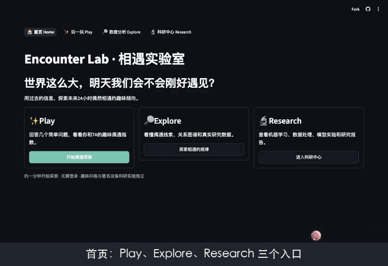

# Encounter Lab · One-page case study

[中文](CASE_STUDY.md) · [Full report (Chinese)](../deliverables/v2/Encounter_Lab_Full_Report_v2.md) · [Live demo](https://hjm59payrde6ronekgiqsn.streamlit.app/) · [Code](../README.en.md)

## Problem

**Two people who were recently in contact: will they be in contact again within the next 24 hours?** Inputs use only records before the prediction time t; the target is a Bluetooth proximity record in (t, t+24h]. Candidates are pairs that met within one day before t, so this is **repeat-contact prediction**: it does not predict first meetings between strangers, and Bluetooth proximity is only a proxy for meeting.

## Data

Anonymized Bluetooth scans from the Copenhagen Networks Study: 692 participants, 28 days, 2.43 million valid contact records at 5-minute scan resolution. "No contact" counts as a negative only for a completely and sufficiently scanned horizon; otherwise it is **Unknown** and stays out of every binary metric. SocioPatterns and other sources lack reliable negatives and are used only for descriptive analysis and positive retrieval.

## Method

- **Leakage control**: chronological train/validation/test splits that purge 24-hour label windows crossing a boundary; thresholds and every choice use validation data only; protocols and fold plans are frozen and hashed before fitting.
- **Features**: contact counts, contact days, time since last contact, common neighbours and scan coverage inside [t−1/3/7 days, t) only.
- **Models**: historical frequency, logistic regression, XGBoost, and a label-free per-pair **Hawkes self-exciting process**.
- **Evaluation**: 11 rolling-origin test days; per-participant Precision@K and NDCG@K; day-block bootstrap; and a **participant holdout** with people never seen in training.

## Three findings

1. **Longer history predicts better.** 7-day XGBoost reaches pooled AP 0.662, +0.090 over 1 day (day-block 95% interval [0.073, 0.103]), positive on all 11 days.
2. **The signal is mostly the recent timing of contacts.** A label-free Hawkes process with two parameters per pair reaches 0.629; adding it to XGBoost as features adds only +0.003. Low-AP days are mostly days with few positives, not worse ranking (daily AP vs. hours since last contact: ρ = −0.86).
3. **It still works for unseen people.** Training only on pairs within one half of the participants and testing on pairs within the other half gives AP 0.651, about 0.017 below the model that saw everyone; that gap also includes the effect of less training data.

## Limitations

One population over about four weeks; all test days had been evaluated before, so the findings are descriptive; intervals describe day-to-day variation while the same people recur across days; scan coverage only approximates being online. Not suitable for real-time prediction, tracking individuals or any high-stakes decision.

## Engineering and delivery

A Streamlit app with four entries (Home / Play / Explore / Research); the Time Machine simulates history as predict → freeze → reveal. 541 tests; GitHub Actions runs three required jobs (full tests, a 15-route smoke test, repository and secret scanning). Raw data, models and per-sample results never enter Git. Code is released under GPL-3.0.
